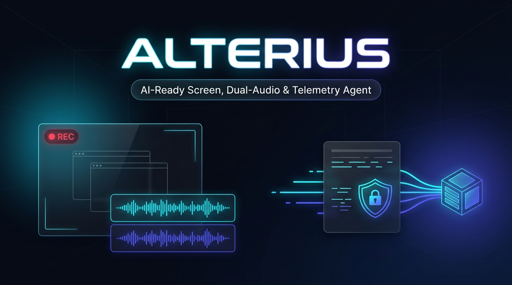
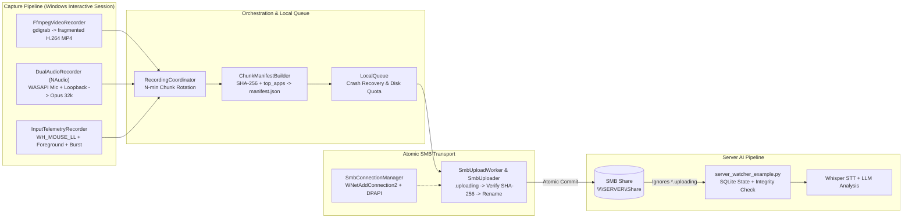

<div align="center">



# 🛰️ Alterius

**AI-Ready Windows Background Agent for Screen, Dual-Audio & Input Telemetry with Atomic SMB Sync**

[](https://dotnet.microsoft.com/download/dotnet/8.0)
[-0078D6?logo=windows&logoColor=white)](#требования-и-установка-ffmpeg)
[](#-ключевые-возможности)
[](#-приватность-и-безопасность)
[](#-серверный-обработчик-server_watcher_examplepy)
[](LICENSE)

[**🇷🇺 О проекте**](#-о-проекте-ru) · [**✨ Возможности**](#-ключевые-возможности) · [**🏗️ Архитектура**](#%EF%B8%8F-архитектура) · [**📦 Формат чанка**](#-формат-чанка-и-smb-структура) · [**🚀 Сборка**](#-сборка-и-запуск) · [**⚙️ Конфигурация**](#%EF%B8%8F-конфигурация-configjson) · [**🇬🇧 English**](#-overview-en)

</div>

---

## 🇷🇺 О проекте (RU)

**Alterius** — это лёгкий фоновый трей-агент для **Windows 10/11** на **C# (`.NET 8`, `net8.0-windows`)**, который синхронно записывает экран, раздельные аудиоканалы (микрофон пользователя + системный звук / голос собеседников) и структурированную телеметрию интерфейса **без перехвата нажатий клавиш**.

Запись автоматически нарезается на независимые чанки (по умолчанию 15 минут) с контрольными суммами **SHA-256** и атомарно выгружается на сетевую **SMB-шару** в формате, сразу готовом для серверного AI-пайплайна (**Whisper** + **LLM**).

---

## ✨ Ключевые возможности

| Модуль | Что делает | Технические детали |
| :--- | :--- | :--- |
| **🖥️ Видеозахват** | Непрерывная запись основного или всех мониторов | `ffmpeg.exe` (`gdigrab`), 1–5 FPS, `libx264` (`ultrafast`, CRF 30, `yuv420p`), масштабирование `1280×720` / `1920×1080`, фрагментированный MP4 (`+frag_keyframe+empty_moov`) с мягкой остановкой через `'q'` в `stdin`. |
| **🎙️ Двухканальное аудио** | Раздельная запись микрофона и системного звука | `NAudio` (`WasapiCapture` + `WasapiLoopbackCapture`), downmix в моно + ресемплинг `48 kHz` (`WdlResamplingSampleProvider`), авто-дополнение тишины (>250 мс) для A/V-синхронизации, кодирование в **Opus 32 kbps VBR (`voip`)**. |
| **🖱️ Телеметрия без кейлоггера** | События мыши, смена окон, плотность печати | Неблокирующий `WH_MOUSE_LL` в отдельном STA-потоке через `Channel<T>` (`mouse_click`, `mouse_move` с троттлингом 300 мс / >15 px, `mouse_wheel`), `window_focus` (`process_name`, `window_title`, `hwnd`) и опциональный анонимный счётчик `typing_burst`. |
| **📡 Атомарный SMB-синк** | Надёжная доставка чанков на сетевую шару | Win32 `WNetAddConnection2`, загрузка во временную папку `*.uploading`, сверка размеров и **SHA-256** на сервере, атомарный `Directory.Move`, ретраи `30с → 60с → 300с`, идемпотентность и квота `MaxLocalBufferGb`. |
| **🛡️ Отказоустойчивость** | Переживает обрывы сети и сбои питания | При старте `LocalQueue.RecoverOrphanedChunksAsync` финализирует незавершённые чанки прошлых сессий (докодирует `.tmp.wav` и собирает `manifest.json`). Корректная остановка при завершении сеанса Windows (`SessionEnding`). |
| **🪟 Системный трей** | Тихая работа без главного окна | Single Instance через `Local\Alterius_SingleInstance_Mutex`, динамическая иконка статуса, диалог настроек с проверкой SMB, быстрый доступ к буферу и логам с ежедневной ротацией. |

### Индикация иконки в системном трее

| Иконка | Состояние | Значение |
| :---: | :--- | :--- |
| ⚪ **Серая** | `Idle` | Агент запущен и ожидает старта записи. |
| 🔴 **Красная** | `Recording` | Идёт запись видео, аудио и телеметрии; SMB-очередь в норме. |
| 🟡 **Жёлтая** | `Warning / Paused` | Ошибка доступа к SMB-шаре, не задан путь SMB при наличии чанков или пауза по квоте буфера. |
| 🟠 **Жёлтая с красным центром** | `Recording + SMB Warning` | Запись продолжается в локальный буфер, но есть ошибка или задержка выгрузки на SMB. |

---

## 🏗️ Архитектура



---

## 🛡️ Приватность и безопасность

- **Без кейлоггера:** при включённом `EnableTypingBurstCounter` хук `WH_KEYBOARD_LL` инкрементирует только атомарный счётчик нажатий за окно (по умолчанию 10 секунд). Параметр `lParam`, виртуальные коды (`vkCode`) и скан-коды (`scanCode`) **никогда не читаются и не сохраняются**.
- **Защита учётных данных SMB:** пароль в `config.json` (`SmbPasswordEncrypted`) шифруется через **Windows DPAPI** (`ProtectedData.Protect`, `DataProtectionScope.CurrentUser` с энтропией `Alterius.DPAPI.v1`) — расшифровать его может только тот же пользователь Windows на той же машине.
- **Целостность данных:** каждый файл в чанке фиксируется в `manifest.json` с размером и хэшем **SHA-256**; серверный обработчик видит чанк только после атомарного переименования из `.uploading`.

---

## 📦 Формат чанка и SMB-структура

Готовые чанки раскладываются на сетевой шаре по иерархии:

```text
\\SERVER\Share\{MachineName}_{WindowsUser}\{yyyy-MM-dd}\{SessionId}\chunk_0001_yyyyMMdd_HHmmss\
├── video.mp4       # Фрагментированный H.264 MP4 (gdigrab + draw_mouse)
├── audio_mic.ogg   # Микрофон пользователя (48 kHz mono, Opus 32 kbps VBR)
├── audio_sys.ogg   # Системный звук / собеседники (WASAPI Loopback, Opus 32 kbps VBR)
├── events.jsonl    # Поток событий мыши, переключений окон и typing_burst
└── manifest.json   # Метаданные сессии, top_apps и SHA-256 каждого файла (пишется последним)
```

> При отсутствии или отключении микрофона/устройства воспроизведения соответствующий `.ogg` пропускается с предупреждением в лог — запись видео и остальных потоков продолжается штатно.

<details>
<summary><b>📄 Пример <code>manifest.json</code> и <code>events.jsonl</code></b></summary>

#### `manifest.json`
```json
{
  "machine_name": "WORKSTATION-01",
  "windows_user": "jdoe",
  "session_id": "session_20261120_093000_a1b2c3",
  "chunk_index": 1,
  "chunk_name": "chunk_0001_20261120_093000",
  "started_at_utc": "2026-11-20T09:30:00Z",
  "ended_at_utc": "2026-11-20T09:45:00Z",
  "duration_sec": 900.0,
  "screen_resolution": "1920x1080",
  "video_target_resolution": "1280x720",
  "files": [
    { "name": "audio_mic.ogg", "size_bytes": 1842100, "sha256": "..." },
    { "name": "audio_sys.ogg", "size_bytes": 1620440, "sha256": "..." },
    { "name": "events.jsonl",  "size_bytes": 94210,   "sha256": "..." },
    { "name": "video.mp4",     "size_bytes": 14820912,"sha256": "..." }
  ],
  "top_apps": [
    {
      "process_name": "Code",
      "active_seconds": 542.4,
      "focus_count": 7,
      "sample_titles": ["RecordingCoordinator.cs - Alterius - Visual Studio Code"]
    }
  ]
}
```

#### `events.jsonl`
```json
{"type":"window_focus","offset_ms":0,"timestamp_utc":"2026-11-20T09:30:00.102Z","window_title":"Alterius - VS Code","process_name":"Code","hwnd":"0x1A04F2"}
{"type":"mouse_click","offset_ms":4210,"timestamp_utc":"2026-11-20T09:30:04.312Z","button":"left","x":960,"y":540,"nx":0.5,"ny":0.5,"window_title":"Alterius - VS Code","process_name":"Code"}
{"type":"typing_burst","offset_ms":10000,"timestamp_utc":"2026-11-20T09:30:10.102Z","window_title":"Alterius - VS Code","process_name":"Code","key_count":48,"window_sec":10}
```

</details>

---

## 📁 Структура репозитория

```text
Alterius/
├── Alterius.sln
├── build.ps1                                   # Скрипт сборки single-file релизов (FD & Self-Contained)
├── server_watcher_example.py                   # Серверный обработчик SMB-шары (SQLite + Whisper/LLM hooks)
├── LICENSE
├── assets/
│   └── banner.jpg
└── src/
    └── Alterius/
        ├── Alterius.csproj                     # .NET 8 (net8.0-windows), NAudio + DPAPI
        ├── Program.cs                          # Точка входа, Single Instance Mutex, глобальные обработчики
        ├── Assets/
        │   └── app.ico
        ├── Models/
        │   ├── AppConfig.cs                    # Конфигурация и нормализация диапазонов
        │   ├── ChunkManifest.cs                # DTO manifest.json (files + top_apps)
        │   ├── RecordingState.cs               # Состояния записи и политики переполнения буфера
        │   └── TelemetryEvent.cs               # Схема записей events.jsonl
        ├── Core/
        │   ├── AppPaths.cs                     # Резолв путей config/buffer/logs/ffmpeg
        │   ├── ChunkManifestBuilder.cs         # Потоковый расчёт SHA-256 и атомарная запись manifest.json
        │   ├── ConfigManager.cs                # Атомарное сохранение config.json с бэкапом битых конфигов
        │   ├── DpapiHelper.cs                  # Шифрование паролей через Windows DPAPI
        │   ├── FileLogger.cs                   # Потокобезопасный логгер с ротацией и очисткой
        │   ├── NativeMethods.cs                # Win32 P/Invoke (Hooks, Foreground, WNet SMB)
        │   └── RecordingCoordinator.cs         # Координатор захвата, ротации чанков и graceful shutdown
        ├── Capture/
        │   ├── Audio/
        │   │   ├── AudioDeviceInfo.cs
        │   │   ├── AudioStreamRecorder.cs      # WASAPI + ресемплинг 48 kHz + silence padding + Opus
        │   │   └── DualAudioRecorder.cs        # Параллельный захват audio_mic и audio_sys
        │   ├── InputTelemetry/
        │   │   ├── ActiveWindowTracker.cs      # Определение процесса и заголовка активного окна
        │   │   └── InputTelemetryRecorder.cs   # STA-поток Win32 hooks + async Channel consumer
        │   └── Video/
        │       └── FfmpegVideoRecorder.cs      # Управление процессом FFmpeg (gdigrab -> fragmented MP4)
        ├── Upload/
        │   ├── LocalQueue.cs                   # Очередь буфера, квота диска и crash recovery
        │   ├── SmbConnectionManager.cs         # Сессии WNetAddConnection2 и тест подключения
        │   ├── SmbUploader.cs                  # Staging *.uploading, проверка SHA-256, атомарный rename
        │   └── SmbUploadWorker.cs              # Фоновый воркер с backoff (30с -> 60с -> 300с)
        └── UI/
            ├── SettingsForm.cs                 # Окно настроек (SMB, видео, аудио, буфер, автостарт)
            ├── TrayApp.cs                      # NotifyIcon, контекстное меню и жизненный цикл
            └── TrayIconFactory.cs              # Генерация чётких 32×32 иконок состояния
```

---

## 🚀 Сборка и запуск

### Требования и установка FFmpeg

- **ОС:** Windows 10 / Windows 11 (x64)
- **SDK для сборки:** [.NET 8 SDK](https://dotnet.microsoft.com/download/dotnet/8.0) или Visual Studio 2022 (17.8+)
- **FFmpeg (обязательно):** статическая сборка Windows x64 с кодеками `libx264` и `libopus` (например, [gyan.dev essentials](https://www.gyan.dev/ffmpeg/builds/) или [BtbN FFmpeg-Builds](https://github.com/BtbN/FFmpeg-Builds/releases)).

Поместите `ffmpeg.exe` в подпапку перед сборкой или рядом с готовым `Alterius.exe`:

```text
<корень_репозитория>\bin\ffmpeg\ffmpeg.exe
```

> Скрипт `build.ps1` автоматически копирует содержимое `bin\ffmpeg\` в оба релизных пакета. Альтернативно путь к `ffmpeg.exe` можно указать в окне **Настройки...** или в `config.json` (`FfmpegPath`), также поддерживается поиск в системном `PATH`.

### Сборка через PowerShell (`build.ps1`)

```powershell
# Сборка обоих single-file вариантов: publish\framework-dependent и publish\self-contained
.\build.ps1

# Только компактный релиз (требует .NET 8 Desktop Runtime на клиентском ПК)
.\build.ps1 -Mode FrameworkDependent

# Только автономный релиз (не требует установки .NET Runtime)
.\build.ps1 -Mode SelfContained -Runtime win-x64
```

### Сборка через `dotnet CLI`

```powershell
dotnet restore Alterius.sln
dotnet build Alterius.sln -c Release
```

---

## ⚙️ Конфигурация (`config.json`)

При первом запуске рядом с `Alterius.exe` автоматически создаётся `config.json`. Логи пишутся в `%LOCALAPPDATA%\Alterius\logs\agent.log` с ежедневной ротацией.

```json
{
  "AutoStartRecording": false,
  "ChunkDurationMinutes": 15,
  "LocalBufferDir": "C:\\Users\\user\\AppData\\Local\\Alterius\\buffer",
  "MaxLocalBufferGb": 5.0,
  "BufferOverflowPolicy": "DeleteOldest",
  "FfmpegPath": "bin\\ffmpeg\\ffmpeg.exe",
  "VideoFps": 2,
  "VideoResolution": "1280x720",
  "CaptureAllMonitors": false,
  "VideoCrf": 30,
  "VideoPreset": "ultrafast",
  "RecordMicrophone": true,
  "RecordSystemAudio": true,
  "MicrophoneDeviceId": null,
  "AudioBitrateKbps": 32,
  "MouseMoveSampleIntervalMs": 300,
  "MouseMoveMinDistancePx": 15,
  "EnableTypingBurstCounter": true,
  "TypingBurstWindowSeconds": 10,
  "SmbSharePath": "\\\\SERVER\\AlteriusShare",
  "SmbUsername": "",
  "SmbPasswordEncrypted": "",
  "UploadPollIntervalSeconds": 15,
  "LogRetentionDays": 14
}
```

<details>
<summary><b>📋 Справочник параметров конфигурации</b></summary>

| Параметр | По умолчанию | Допустимый диапазон / Описание |
| :--- | :---: | :--- |
| `AutoStartRecording` | `false` | Автоматический старт записи сразу при запуске агента. |
| `ChunkDurationMinutes` | `15` | `1..120` мин — длительность одного чанка до ротации. |
| `LocalBufferDir` | `%LOCALAPPDATA%\Alterius\buffer` | Локальная папка буфера для записи и очереди выгрузки. |
| `MaxLocalBufferGb` | `5.0` | `0.2..1000` ГБ — максимальный размер локального буфера. |
| `BufferOverflowPolicy` | `DeleteOldest` | `DeleteOldest` (удаление старых чанков до 90% квоты) или `PauseRecording`. |
| `VideoFps` / `VideoCrf` | `2` / `30` | `1..5` FPS, CRF `18..40`, пресет `ultrafast` (`libx264`). |
| `VideoResolution` | `1280x720` | Целевое ограничение разрешения (сохраняет пропорции и чётность сторон). |
| `CaptureAllMonitors` | `false` | `false` — только основной монитор; `true` — весь `VirtualScreen`. |
| `RecordMicrophone` / `RecordSystemAudio` | `true` / `true` | Независимое включение `audio_mic.ogg` и `audio_sys.ogg`. |
| `AudioBitrateKbps` | `32` | `16..128` kbps — битрейт Opus VBR (`voip`). |
| `MouseMoveSampleIntervalMs` / `MinDistancePx` | `300` / `15` | Троттлинг событий `mouse_move` для компактного `events.jsonl`. |
| `EnableTypingBurstCounter` | `true` | Анонимный счётчик нажатий за `TypingBurstWindowSeconds` (`1..60` сек). |
| `SmbSharePath` / `SmbUsername` | `""` | UNC-путь к шаре и опциональный логин (пусто = текущий пользователь Windows). |
| `SmbPasswordEncrypted` | `""` | Пароль SMB в Base64, зашифрованный Windows DPAPI через окно настроек. |
| `UploadPollIntervalSeconds` | `15` | `5..600` сек — период проверки локальной очереди выгрузки. |
| `LogRetentionDays` | `14` | `1..365` дней — срок хранения архивных логов `agent_yyyy-MM-dd.log`. |

</details>

---

## 🔄 Автозапуск в Windows

> [!IMPORTANT]
> **Alterius** должен запускаться в **интерактивной пользовательской сессии** (не как Windows Service в Session 0), так как захват экрана (`gdigrab`), аудио WASAPI и глобальные хуки (`WH_MOUSE_LL`) требуют доступа к рабочему столу пользователя.

<details>
<summary><b>Способ 1: Папка автозагрузки (<code>shell:startup</code>)</b></summary>

1. Нажмите `Win + R`, введите `shell:startup` и нажмите `Enter`.
2. Создайте ярлык на `Alterius.exe` внутри открывшейся папки.

</details>

<details>
<summary><b>Способ 2: Реестр текущего пользователя (<code>HKCU Run</code>)</b></summary>

```powershell
$exePath = "C:\Program Files\Alterius\Alterius.exe"
Set-ItemProperty -Path "HKCU:\Software\Microsoft\Windows\CurrentVersion\Run" -Name "Alterius" -Value "`"$exePath`""
```

</details>

<details>
<summary><b>Способ 3: Планировщик заданий (Task Scheduler)</b></summary>

```powershell
$action = New-ScheduledTaskAction -Execute "C:\Program Files\Alterius\Alterius.exe"
$trigger = New-ScheduledTaskTrigger -AtLogOn -User $env:USERNAME
Register-ScheduledTask -TaskName "Alterius" -Action $action -Trigger $trigger -Description "Alterius background screen, dual-audio and telemetry agent"
```

</details>

---

## 🤖 Серверный обработчик (`server_watcher_example.py`)

На сервере, где смонтирована SMB-шара, можно запустить готовый шаблон `server_watcher_example.py` (**Python 3.10+**, только стандартная библиотека):

```bash
# Непрерывный мониторинг каждые 10 секунд
python server_watcher_example.py --root /mnt/alterius_share --interval 10

# Однократный проход (удобно для cron / проверки)
python server_watcher_example.py --root "\\SERVER\AlteriusShare" --once
```

Что делает скрипт:
1. Рекурсивно ищет завершённые `manifest.json`, **строго пропуская** временные каталоги `*.uploading`.
2. Проверяет размер и **SHA-256** каждого файла чанка перед обработкой.
3. Агрегирует `events.jsonl` в структурированную сводку активности и временную шкалу окон.
4. Предоставляет чистые точки расширения `transcribe_audio_with_whisper()` (для `audio_mic.ogg` + `audio_sys.ogg`) и `analyze_chunk_with_llm()`, сохраняя состояние обработанных чанков в SQLite (`processed_chunks.sqlite`).

---

## 🇬🇧 Overview (EN)

**Alterius** is a lightweight **Windows 10/11** background tray agent built with **C# (.NET 8, `net8.0-windows`)** for synchronized **screen recording**, **dual-channel audio capture** (microphone + WASAPI system loopback in Opus 32 kbps), and **privacy-first input telemetry** (mouse events, active window focus, and optional anonymous typing burst counts — never recording keystrokes).

Recordings are automatically rotated into self-contained time chunks with **SHA-256** manifests (`manifest.json`) and atomically synced to an **SMB share** via `.uploading` staging directories and **DPAPI-encrypted** credentials, ready for downstream **Whisper** transcription and **LLM** analysis using the included [`server_watcher_example.py`](server_watcher_example.py).

---

<div align="center">

Licensed under the **[MIT License](LICENSE)** · Copyright © 2026 Serikov Farhat Ibragymuly

</div>
